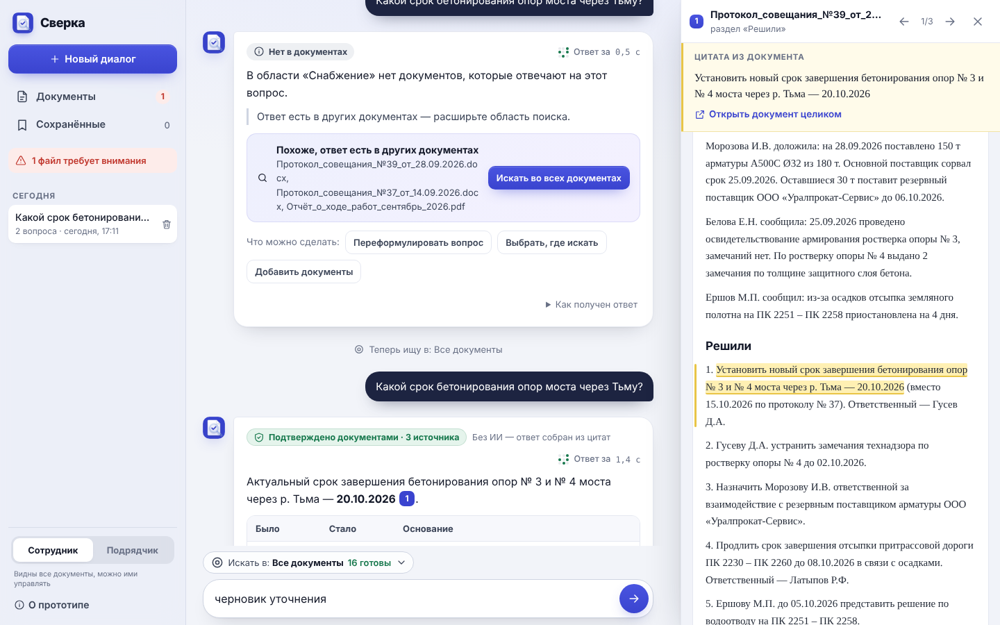

# Сверка — ИИ-агент для поиска по документам

Прототип: пользователь добавляет документы, задаёт вопрос, получает ответ с цитатами и сразу проверяет
его по источнику — на нужной странице или в нужном разделе.

- **Демо:** https://ascld.github.io/sverka-doc-search/
- **Репозиторий:** https://github.com/AsCld/sverka-doc-search
- **Функция модели (GigaChat):** https://sverka-doc-search.vercel.app/api/ask — вызывается из демо автоматически,
  проверяющему ключи не нужны. Если она недоступна, приложение работает в режиме «ответ из цитат».

Как проверить за 3 минуты (лучше с телефона — интерфейс сделан в первую очередь под узкий экран): открыть демо →
«Загрузить демо-набор» → дождаться, пока кольцо готовности заполнится (скан останется с ошибкой — так задумано) →
нажать пример вопроса → нажать ссылку [1] (на телефоне снизу выезжает цитата, потянуть вверх — весь документ) →
спросить «А кто за это отвечает?» → вкладка «История» → вернуться к прошлому диалогу → переключить роль на
«Подрядчик» (кнопка «Сотрудник ⌄» в шапке или переключатель внизу бокового меню) и увидеть, что документов стало один.
Полный список проверочных вопросов — в [docs/DEMO.md](docs/DEMO.md).

| Материал | Где |
|---|---|
| Продуктовая концепция, решения, модель доступа, доп. функции, план | [docs/PRODUCT.md](docs/PRODUCT.md) |
| Демо-документы и вопросы с местом подтверждения | [docs/DEMO.md](docs/DEMO.md) |
| Скриншоты (компьютер и телефон) | [docs/screens](docs/screens) |
| Реальное и моделируемое, ограничения, ИИ, время | ниже в этом файле |



## Что реализовано

Сверено с обязательным объёмом задания (разделы 03–06). Всё перечисленное работает в опубликованном демо.

**Чат (раздел 03)**

- Стартовый экран без рекламного текста: карточка базы с кольцом готовности («16/17 готовы к поиску», фрагменты,
  коллекции, ошибки; по нажатию — документы) и шесть примеров вопросов — по одному на тип проверки: факт, сводка,
  «что изменилось», технадзор, регламент, «нет в документах». У роли «Подрядчик» — свои примеры.
- Ввод и отправка вопроса (Enter, Shift+Enter — новая строка, «/» — к полю ввода), сообщения пользователя и агента.
- Ожидание ответа показывает реальный ход работы: сколько фрагментов и из каких документов нашёл поиск →
  модель пишет ответ → сколько цитат прошло сверку. Ответ можно остановить.
- Ответ: вердикт («Подтверждено документами · N источников», «Подтверждено частично», «Нет в документах»),
  текст, список или таблица по смыслу вопроса, ссылки [n], «Как получен ответ», копирование, сохранение,
  уточняющие вопросы-подсказки.
- Источники: карточка с типом файла и номером ссылки, ориентир (страница или раздел) и подтверждающий фрагмент.
  На компьютере источник открывается в панели справа, на телефоне — листом снизу в два положения: сначала
  только цитата (чат виден под ней), потянуть вверх или «Показать в документе» — весь текст с подсветкой,
  вниз — назад и закрыть. Между источниками можно листать (1/3), возврат — без потери черновика и прокрутки.
- Вопрос по фрагменту: выделить текст в документе или источнике → «Спросить об этом» — фрагмент уходит в поле
  вопроса (в источнике — уточнение в том же диалоге, на странице документа — новый вопрос по этому документу).
- Уточняющий вопрос с контекстом диалога, новый диалог, история («Сегодня», «Ранее»; на телефоне — отдельная
  вкладка), возврат к прошлому, удаление.
- Нет информации — явное «Нет в документах»: чего не нашлось, ближайшие фрагменты, подсказка «ответ есть вне
  области» с кнопкой поиска во всех документах. Ошибка ответа — сообщение и «Повторить».
- Область поиска: все документы, коллекция или выбранные файлы. Видна над полем ввода со счётчиком готовых
  документов; если готовых нет, объясняется почему и что сделать.

**Документы (раздел 04)**

- Добавление одного или нескольких файлов: выбор на компьютере или перетаскивание в любое место окна
  (в открытую коллекцию). PDF, DOCX, TXT, MD до 15 МБ.
- Список с типом, размером, числом страниц/разделов и статусом: «В очереди» → «Обработка» (с этапом) →
  «Готов к поиску» или «Ошибка чтения». Поиск по названию, фильтры по статусу, группировка по коллекциям.
- Коллекции: создание, переименование, удаление; перемещение документов по одному и массово.
- Удаление — в корзину с «Отменить»; в корзине — восстановление и удаление навсегда с подтверждением.
- Просмотр документа: извлечённый текст с номерами страниц или разделами.
- Массовые действия: спросить по выбранным, повторить обработку, переместить, удалить.
- Все обязательные состояния — первый запуск, обработка, готовность, ошибка, поиск без результатов, ожидание
  ответа, нет информации — с понятным сообщением и следующим действием.

**Почему в демо-наборе есть файл с ошибкой.** `Скан_акта_КС-2_август_2026.pdf` положен туда нарочно: это PDF
без текстового слоя (скан), и на нём видно состояние «Ошибка чтения» — сообщение «В PDF нет текстового слоя
(похоже на скан)…», счётчик «требует внимания», фильтр «Ошибки». Остальные 16 документов готовы к поиску,
скан в ответах не участвует. В интерфейсе это подписано прямо под ошибкой.

**Дизайн и реализация (раздел 05)**

- **Сначала телефон.** Нижние вкладки «Чат · История · Документы · Сохранённые» под большим пальцем, бегунок
  едет к активной; в диалоге и документе вкладки прячутся, в шапке — «назад». Окна (область поиска, перемещение,
  роль) на телефоне — листы снизу; таблица ответа на узком экране превращается в стопку карточек «столбец → значение»;
  у документов — плавающая кнопка «+». При вводе вопроса вкладки убираются, чтобы не занимать место над клавиатурой.
  На компьютере — боковое меню с историей и панель источника справа. Можно добавить на экран «Домой» (manifest, иконки).
- **Свой визуальный язык «сверки»:** интерфейс набран гротеском, текст документов и цитаты — антиквой; жёлтый
  маркер — только для дословного текста источника; синий логотипа — действия и ссылки; тёмно-синий фона логотипа —
  «бумага» вопроса и уведомлений. Без декоративного фона и заголовков-лозунгов: первое, что видно, — состояние базы.
- **Движение работает на смысл, а не украшает:**
  - заставка из логотипа (один раз за вкладку): знак всплывает на пружине, по нему проходит блик, название и подпись
    поднимаются следом, затем знак перелетает на место логотипа в шапке, а приложение раскрывается из-под фона;
  - вопрос «перелетает» из примера или поля ввода в пузырь сообщения (View Transitions API);
  - ход ответа на реальных данных: найденные документы → заготовки карточек источников с типами файлов
    (скелеты) → модель пишет → сверенные цитаты отмечаются по одной; ответ появляется в порядке чтения
    (вердикт «ставится печатью» → текст → ссылки → источники), цитата в документе «проводится маркером»;
  - переходы между экранами по направлению: вкладка правее — экран въезжает справа, вложенный экран — «вперёд»,
    возврат — «назад»; смена роли раскрывается кругом от переключателя;
  - кольцо готовности доезжает до нового значения по мере обработки файлов; документы в очереди показывают
    скелет вместо ещё неизвестных метаданных; смена статуса «отщёлкивается».
  Анимируется только новое: перерисовка экрана не запускает анимацию заново. Только `transform` и `opacity`
  там, где это возможно. Если в системе включено «уменьшить движение», анимаций и заставки нет.
- Компоненты по мотивам [animata.design](https://animata.design) (MIT), переписаны на ванильный JS/CSS:
  **Donut Chart** — кольцо готовности базы (стартовый экран, сводка документов); **Skeleton List / Wide Card** —
  заготовки строк документов в очереди и карточек источников, пока агент ищет.
- Микровзаимодействия из [React Bits](https://reactbits.dev) (MIT + Commons Clause) перенесены с React на ванильный JS
  по исходникам из их реестра — с теми же длительностями и кривыми, но с цветами и радиусами приложения
  (`js/fx.js`, `js/crumple.js`; над каждым блоком — ссылка на оригинал):
  - **LatticeLoader** — ход ответа: сетка 3×3 «думает» волной рядом с живым секундомером, по готовности
    складывается в галочку — «Ответ за 3,4 с» (при сбое — крестик). Та же сетка — индикатор обработки документов.
  - **FuseButton** — удаление с отменой на «горящем шнуре»: на странице документа «Удалить» → «Вернуть»
    (5 с), в уведомлении «Отменить» показывает, сколько осталось на отмену; наведение ставит шнур на паузу, Esc — отмена.
  - **PaperCrumple** — документ, отправленный в корзину, сминается в бумажный комок с его названием (WebGL, three.js)
    и летит к ссылке «Корзина». Только на компьютере; без WebGL или при «уменьшить движение» анимации нет.
  - **SpotlightCard** — пятно света под курсором на карточках (только мышь).
  - **CountUp** — числа готовности и фрагментов «добегают» по мере обработки файлов.
- Основные действия доступны с клавиатуры, фокус виден, у кнопок есть подписи; цели нажатия на телефоне ≥ 40 px.
- Состояние сохраняется после обновления страницы; прямые ссылки на экраны и на конкретный источник;
  секретов в репозитории и браузере нет.

**Роли и модель доступа (демо)**

- Переключатель «Сотрудник / Подрядчик» (на компьютере — внизу бокового меню, на телефоне — кнопка «Сотрудник ⌄» в шапке).
  Настоящей авторизации нет — роль показывает модель доступа из [docs/PRODUCT.md](docs/PRODUCT.md#модель-доступа).
- Доступ выдаётся на коллекцию (в интерфейсе — «папка»): сотрудник включает «Открыта подрядчикам» у коллекции (в демо так открыта
  «Для подрядчиков»). Подрядчик видит только такие коллекции, не загружает, не перемещает и не удаляет файлы,
  корзины у него нет; у ролей раздельные история и сохранённые ответы.
- **Фильтр до поиска:** агент получает только доступные роли документы, поэтому закрытое не всплывает ни в ответе,
  ни в подсказке «ответ есть вне области» — на вопрос про бетонирование подрядчик получает «Нет в документах»,
  без намёка на протоколы.
- **«Можно переслать подрядчику»** — под ответом сотрудника видно, лежат ли все источники в открытых подрядчикам
  коллекциях. Если нет — «Только для сотрудников»: подрядчик, получив такой ответ, не сможет проверить его по источникам.

**Данные и ИИ (раздел 06)**

- 17 вымышленных документов стройки участка ВСМ в шести коллекциях (PDF, DOCX, TXT, MD: протоколы, отчёты
  за август и сентябрь, график, акт и предписание технадзора, испытания бетона, журнал входного контроля, письмо
  поставщика, регламенты, памятка для подрядчиков, скан) и 27 проверочных вопросов с местом подтверждения —
  [docs/DEMO.md](docs/DEMO.md): поиск факта, сводка по нескольким источникам, сравнение «было/стало», уточнение,
  отсутствие информации. Документы согласованы между собой: цифры и даты одного повторяются в других.
- Ответы пишет GigaChat по найденным фрагментам, каждая ссылка сверяется с текстом документа; запасной режим
  без модели помечен в ответе. Свой файл читается по-настоящему — поведение описано в DEMO.md.

## Стек

- HTML + CSS + JavaScript (ES-модули) без фреймворков и сборки — для прототипа такого объёма сборка
  не нужна, а код читается и правится напрямую.
- [pdf.js 3.11](https://mozilla.github.io/pdf.js/) (Apache-2.0) лежит в `vendor/` — приложение не зависит от CDN.
- [three.js r180](https://threejs.org) (MIT) в `vendor/three/` — только для анимации «бумажного комка», грузится лениво.
- DOCX разбирается без библиотек: zip распаковывается встроенным в браузер `DecompressionStream`, XML — `DOMParser`.
- Хранение — `localStorage` браузера.
- Ответы пишет **GigaChat** (`GigaChat-2-Max`, бесплатный режим Freemium для физлиц) через одну серверную функцию
  `api/ask.js` на Vercel (Node.js, без зависимостей). Ключ хранится только в переменной окружения Vercel.
  Серверы GigaChat подписаны сертификатом НУЦ Минцифры, которого нет в стандартном наборе Node.js, —
  публичные корневой и промежуточный сертификаты лежат в `api/_ca.js` и добавляются к стандартным.
  GitHub Pages не умеет выполнять серверный код, поэтому функция развёрнута отдельно, а сайт обращается к ней по HTTPS.
- Проверка — Node.js 20+ (`node --test`) и Playwright (Chromium).

## Запуск локально

Нужен любой статический сервер (из `file://` ES-модули не загрузятся):

```bash
python3 -m http.server 8080        # или: npm start
# открыть http://localhost:8080/
```

Локальная копия тоже обращается к функции модели на Vercel (адрес — константа `API_URL` в `js/agent.js`).
Если функция недоступна, ответы идут в режиме «ответ из цитат». Секретов в репозитории и клиентском коде нет.

Проверки:

```bash
npm install                        # ставит только Playwright для e2e
npm test                           # модульные проверки поиска и агента (без браузера)
npx playwright install chromium    # один раз
npm run test:e2e                   # 25 шагов сценария из задания в Chromium; SHOTS=1 — обновить скриншоты
```

Демо-документы генерируются скриптом `python3 tools/make_demo.py` (python-docx, reportlab, Pillow);
готовые файлы уже лежат в `demo/`.

## Подключение модели (Vercel)

1. Ключ: https://developers.sber.ru/studio → *Создать проект* → GigaChat API (физлицо) → *Настройки API* →
   *Получить ключ* → скопировать «Ключ авторизации».
2. vercel.com → *Add New → Project* → импортировать этот репозиторий (настройки сборки не нужны,
   `vercel.json` отключает установку зависимостей — функции они не нужны).
3. *Settings → Environment Variables*: `GIGACHAT_AUTH_KEY` = ключ авторизации. Необязательно: `GIGACHAT_MODEL`
   (по умолчанию `GigaChat-2-Max`; `GigaChat-2-Pro`, `GigaChat-2` — быстрее), `GIGACHAT_SCOPE` (для юрлиц).
4. *Deploy*. Функция будет доступна по `https://<проект>.vercel.app/api/ask`; если адрес отличается от
   `API_URL` в `js/agent.js` — поправить константу.
5. Проверка: `curl -X POST https://<проект>.vercel.app/api/ask -H 'content-type: application/json'
   -d '{"question":"Сколько техники в ремонте?","fragments":[{"doc":"Отчёт","where":"стр. 1","text":"Техника: 96 единиц, из них 7 в ремонте."}]}'`

Сменить ключ или модель — поменять переменную на Vercel и сделать *Redeploy*, код не трогать.

## Публикация на GitHub Pages

1. Залить содержимое репозитория в ветку `main` (сборка не нужна).
2. Settings → Pages → Source: *Deploy from a branch*, Branch: `main`, папка `/ (root)`.
3. Через 1–2 минуты сайт доступен по `https://<user>.github.io/<repo>/`.

Почему это работает без настроек: все пути относительные (приложение открывается из любой подпапки),
маршрутизация через `#/…` (обновление страницы и прямые ссылки не дают 404), файл `.nojekyll` отключает
обработку Jekyll. Примеры прямых ссылок: `#/docs`, `#/docs/trash`, `#/saved`, `#/c/<id>?src=<ответ>:<n>`.

## Устройство

```
index.html          каркас страницы
css/app.css         вся визуальная система, адаптив
js/app.js           маршрутизация, каркас (боковое меню / шапка и вкладки), панель и лист источника, история,
                    «Сохранённые», роли, вопрос по выделению, заставка, «О прототипе», перетаскивание
js/chat.js          экран чата: стартовый экран, сообщения, ответы, область поиска, ввод
js/docs.js          раздел «Документы», корзина, страница документа
js/viewer.js        отображение текста документа с подсветкой цитаты
js/fx.js            микровзаимодействия: кольцо готовности (animata), решётка, шнур отмены, свет под курсором, счётчики (React Bits)
js/crumple.js       смятие документа в бумажный комок (порт PaperCrumple, three.js)
js/store.js         состояние, сохранение в localStorage, очередь обработки файлов
js/ingest.js        извлечение текста: PDF (страницы, разделы), DOCX (разделы, таблицы), TXT, MD
js/search.js        стемминг, фрагменты, BM25, «покрытие» вопроса
js/agent.js         логика агента: область → поиск → ответ модели → сверка цитат (или запасной режим)
api/ask.js          серверная функция Vercel: фрагменты + вопрос → GigaChat → JSON {ответ, цитаты, уточнения}
api/_ca.js          публичные сертификаты НУЦ Минцифры для соединения с GigaChat
vercel.json         настройка деплоя функции
demo/               демо-документы и manifest.js (коллекции, примеры для обеих ролей, подготовленные ответы)
icons/              иконки из логотипа (вкладка, «Домой»), слои заставки; manifest.webmanifest — установка на телефон
tools/              make_demo.py — демо-документы; splash_assets.py — нарезка заставки из логотипа
tests/              модульные и e2e-проверки, мини-сервер
```

Поток данных: **интерфейс** (`chat.js`, `docs.js`) вызывает действия **хранилища** (`store.js`) и
**агента** (`agent.js`). Хранилище после загрузки файла передаёт его в `ingest.js`, сохраняет
извлечённые блоки `{страница, раздел, текст}` и уведомляет интерфейс. Агент не знает про DOM:
получает вопрос, историю диалога, область и документы — возвращает объект ответа
`{вердикт, блоки, источники[{документ, страница, раздел, цитата}]}`, который рисует `chat.js`.
Поэтому логику агента можно проверять в Node без браузера.

Ответ модели: `agent.js` ищет до 8 фрагментов BM25 в области, отправляет их с вопросом и двумя прошлыми парами
«вопрос — ответ» в `api/ask.js`. Функция получает токен доступа (живёт 30 минут, кэшируется), просит GigaChat ответить только по фрагментам,
ставить ссылки [n] и для каждой ссылки дать дословную цитату; ответ принимается вызовом функции `answer`, то есть JSON по схеме.

Сверка в браузере (`verifyModel` в `agent.js`), для каждой ссылки [n]:
1. цитата модели ищется во фрагменте n без учёта регистра и пунктуации — в источнике показывается точный текст документа;
2. если модель цитату не дала или исказила — берётся предложение фрагмента, где есть не меньше половины слов утверждения;
3. каждое число и дата утверждения должны встречаться в цитируемых фрагментах или названиях их документов.

Не прошла хоть одна проверка, модель не ответила за 45 с или функция недоступна — показывается ответ без модели
с пометкой «Без ИИ» и причиной в «Как получен ответ». Если модель не нашла ответа, а поиск нашёл, показывается ответ поиска.

## Что реально, а что моделируется

**Работает по-настоящему**

- Извлечение текста из PDF (с реальными номерами страниц и разделами), DOCX (разделы, таблицы), TXT, MD.
- Ошибки чтения: скан без текста, пустой файл, неподдерживаемый формат, файл больше 15 МБ, повреждённый DOCX/PDF.
- Поиск: стемминг Snowball для русского, фрагменты ~500 символов (строка таблицы — отдельный фрагмент),
  BM25, небольшой словарь синонимов предметной области.
- «Нет в документах»: если ключевого слова вопроса нет ни в одном документе или найденные фрагменты
  покрывают меньше половины смыслового веса вопроса (по IDF), агент не отвечает, а объясняет, чего не нашёл.
- Подсказка «ответ есть вне области» — реальный поиск по документам за пределами области.
- **Ответ пишет модель GigaChat** по найденным фрагментам; каждая ссылка проверяется по тексту документа
  (см. «Устройство»). Модель также предлагает уточняющие вопросы под ответом.
- Уточняющие вопросы: при ссылке на прошлый вопрос («это», «он», «а кто…») или слишком коротком вопросе
  к поиску добавляются слова предыдущего вопроса.
- Хранение документов, диалогов, области, черновиков и сохранённых ответов после обновления страницы.

**Моделируется**

- **Запасной режим без модели** (лимит, сбой сети, ответ не прошёл сверку, локальный запуск без функции):
  на 20 демонстрационных вопросов (и их переформулировки) даются заранее подготовленные связные ответы.
  Перед показом каждая цитата такого ответа ищется в тексте обработанного документа внутри текущей области;
  если хотя бы одна не найдена, подготовленный ответ не используется, работает обычный поиск. На остальные
  вопросы ответ — дословные найденные цитаты без пересказа. В интерфейсе под каждым ответом есть «Как получен ответ».
- Паузы: обработка файла и «шаги» ответа немного замедлены, чтобы состояния были различимы.
- Ошибку ответа можно вызвать вручную: «О прототипе» → «Смоделировать ошибку следующего ответа».
- Роли: переключаются вручную, без входа и паролей; права и фильтр по коллекциям работают в браузере.
  Модель доступа — в [docs/PRODUCT.md](docs/PRODUCT.md#модель-доступа).

## Ограничения

- Данные живут в одном браузере (localStorage, ~5 МБ ≈ сотни страниц текста). При переполнении показывается ошибка.
  Две открытые вкладки не синхронизируются.
- Оригиналы файлов не хранятся: после обновления страницы во время обработки свой файл нужно загрузить снова
  (демо-файлы дообрабатываются сами). По той же причине «Повторить» для своих файлов работает в пределах сессии.
- Нет OCR: сканы без текстового слоя не читаются.
- Поиск лексический: синонимы вне небольшого словаря и перефразирование он не понимает
  (например, «марка бетона» не найдёт «Бетон В35»; ближайшие фрагменты при этом показываются).
- В DOCX нет страниц, поэтому ориентир — раздел (по стилям заголовков).
- Модель видит только найденные поиском фрагменты: если BM25 не нашёл нужный фрагмент, модель ответит
  «нет в документах». Сверка гарантирует, что каждая цитата есть в документе, но не что каждое слово
  пересказа совпадает с цитатой — поэтому цитаты всегда показаны рядом с ответом.
- Бесплатный режим GigaChat для физлиц: один поток — если два человека спросят одновременно, второй получит
  ответ без модели; лимит токенов на год (для демо хватает с большим запасом).
- Функция развёрнута на Vercel за рубежом: фрагменты проходят через неё транзитом. Для реальных документов
  функция должна работать в РФ (например, Yandex Cloud Functions) — код переносится без изменений.
- Функция модели открыта для любых сайтов и не ограничивает частоту запросов (защищает только квота ключа).
- Нет пагинации списка документов — при объёме прототипа хватает группировки, поиска и фильтров.

## Проверки

- `npm test` — 14 модульных проверок: стемминг, разбиение на предложения, BM25 с номером страницы,
  ответ из цитат, «нет информации», ограничение областью, контекст уточнения, пустая область,
  поиск цитаты модели в тексте, ответ модели с перенумерацией ссылок, запасной режим при лимите и при выдуманной цитате,
  подтверждение ссылки без цитаты, отказ при выдуманном числе, даты из названий документов, «нет ответа» модели против найденного поиском, очистка протёкшего в ответ JSON.
- `npm run test:e2e` — 25 шагов (функция модели подменяется: по умолчанию «недоступна», в шаге 11 — ответ
  с верной и с выдуманной цитатой) в Chromium по сценарию из задания: первый запуск, загрузка демо-набора и статусы,
  поиск и фильтры, просмотр документа, область поиска, ответ с источниками, открытие источника и возврат
  с сохранением черновика, уточнение, «нет информации», обычный поиск, сохранение ответа, новый диалог
  и возврат к старому, ошибка ответа и повтор, перемещение, удаление с отменой и корзина, массовые действия,
  загрузка своих TXT и XLSX, перетаскивание, обновление страницы и прямые ссылки, экран 390 px без
  горизонтальной прокрутки, лист источника на телефоне (цитата → документ → назад → закрыть перетаскиванием),
  вкладки и история, клавиатура, ответ модели и отклонение ответа с выдуманной цитатой, вопрос по выделенному
  фрагменту, роль «Подрядчик» (один документ, закрытое не подсказывается), выдача доступа к коллекции и метка
  «можно переслать подрядчику», заставка не держит клики. Плюс проверка, что в консоли нет ошибок.
- Вручную по скриншотам: компьютер 1440 px и телефон 390 px (`docs/screens`), отдельно — режим «уменьшить
  движение» (всё видно сразу, ничего не «застревает» невидимым), заставка, перелёт вопроса и смена роли — покадрово.

## Как использовался ИИ

**Инструменты.** Claude (Anthropic) в режиме Cowork — разбор задания, проектирование, код, демо-документы,
тесты, тексты README; Playwright — прогон сценариев и скриншоты для визуальной проверки.

**Как проверялись предложения ИИ.** Ни один фрагмент не принимался «на слово»: логика поиска проверялась
на реальном тексте демо-документов (извлечение в Chromium + прогон 20+ вопросов с разбором каждого ответа),
интерфейс — e2e-сценарием и просмотром скриншотов на двух ширинах экрана.

**Ошибки, найденные и исправленные в процессе**

1. Стеммер не сводил короткие формы («Тьма/Тьму», «дня/дней») — добавлены обработка коротких слов и словарь нерегулярных форм.
2. На «Какой бюджет строительства участка?» поиск находил «строительство участка» и выдавал это за ответ —
   добавлены правило «слова нет ни в одном документе» и покрытие вопроса, взвешенное по IDF.
3. Неизвестные глаголы («находится») давали ложное «нет информации»; при этом «бюджет» ошибочно
   распознавался как глагол из-за окончания «-ет» — правило уточнено.
4. Однокоренные варианты слова суммировались и вытесняли точное совпадение (строку таблицы с поставщиком) —
   каждый термин вопроса теперь даёт вклад один раз, по лучшему варианту.
5. Ошибка выбора «ключевого» термина приводила к ответу с нулём фрагментов — исправлено и добавлена защита.
6. PDF: заголовки с «р. Тьма» не распознавались, даты в начале строки принимались за пункты списка —
   заголовки определяются по размеру шрифта, правило пунктов ужесточено.
7. Подготовленный ответ «кто отвечает за бетонирование» срабатывал на «Кто входит в комиссию…» — сопоставление сужено.
8. Сохранение при закрытии вкладки могло перезаписать более новые данные — теперь дописываются только несохранённые изменения.
9. Панель области поиска перерисовывалась при каждом изменении состояния и сбрасывала фокус клавиатуры — теперь только при изменении содержимого.
10. Скрытое мобильное меню оставалось доступным с клавиатуры — скрыто полностью.
11. pdf.js с CDN оказался недоступен в среде проверки — библиотека перенесена в репозиторий, внешних зависимостей во время работы нет.
12. После подключения модели e2e-тест «новый диалог» начал падать: тест ждал исчезновения индикатора ответа
    раньше, чем тот появлялся на новом экране, и читал историю до перехода в старый диалог. Исправлено ожиданием
    готового ответа и нужного текста, а не таймингов.

13. Проверка на живом GigaChat: модель иногда ссылается на фрагмент, не давая для него цитату, и оставляет в конце ответа
    хвост JSON (`",`) — из-за этого почти половина ответов уходила в запасной режим. Добавлены подтверждение ссылки
    предложением фрагмента и проверка чисел и дат (ловит выдуманные цифры), хвост очищается. Ложные срабатывания
    проверки чисел (дата из названия документа, «28 сентября» при «28.09.2026» в тексте) найдены на тех же прогонах и исправлены.
    Второй прогон (12 вопросов сценария на опубликованном сайте) показал ещё два дефекта GigaChat: иногда модель дописывает
    остаток JSON (`quotes: [ {…`) внутрь текста ответа, а изредка «зацикливается» и отвечает больше минуты. Функция теперь
    отрезает такую протечку и достаёт из неё цитаты, ответ ограничен 1000 токенами, браузер ждёт модель не дольше 45 с.
    Третий прогон (сценарий раздела 07 с чистого листа: первый запуск, демо-набор, вопрос, источник, уточнение, новый диалог,
    сводка, «нет информации», возврат, обновление страницы, прямая ссылка на источник) прошёл; найдены и исправлены
    дважды экранированные переводы строк (`\n` в тексте списка) и вторая форма протечки (`quotes [` без двоеточия).
14. Первым подключили Gemini, но Google AI Studio недоступен из РФ, а обходить региональные ограничения ради
    ключа рискованно (ключ могут заблокировать). Перешли на GigaChat — интерфейс функции и проверка цитат
    в браузере не изменились, переписан только `api/ask.js`. Сертификаты НУЦ Минцифры перенесены из
    официального источника, их отпечатки SHA-256 сверены с исходными файлами, цепочка проверена `openssl verify`.

15. Интерфейс перерисовывается целиком при каждом изменении состояния, поэтому CSS-анимации запускались бы
    заново на каждом шаге ответа и при каждом обновлении статуса документа. Учтено до появления дефекта:
    анимацию получает только элемент, показанный впервые (ключи `data-k`, функция `reveal` в `ui.js`);
    старые сообщения при открытии диалога не анимируются.
16. На скриншотах 390 px нашлось: стартовый экран на телефоне открывался прокрученным к полю ввода, заголовок
    и назначение продукта были не видны (поведение «прокрутить к последнему сообщению» срабатывало и без сообщений). Исправлено.
17. Расширение демо-набора: все 8 новых подготовленных ответов прогнаны на реальном извлечении текста в Chromium —
    каждая цитата нашлась в своём документе; заодно проверено, что новые документы не сломали старые сценарии
    («бюджет» по-прежнему «нет в документах», вопрос про бетонирование в области «Снабжение» — без ответа).
    Для таблиц в MD добавлен разбор строк «| … |» в ячейки — иначе таблица журнала склеивалась в одну строку.
18. Порты React Bits: страницы библиотеки рисуются скриптом, поэтому код брался из JSON-реестра. На скриншотах
    нашлось: счётчики CountUp во время «добегания» показывали «96 фрагмента» и «4 коллекций» (подпись склонялась
    по итоговому числу) — подписи вынесены перед числом. «Бумажный комок» в безголовом Chromium без видеокарты
    рисуется 2–3 кадрами, поэтому проверен покадрово: кадры смятия отрисованы в canvas и просмотрены.
    e2e-тест «обновление страницы» иногда читал localStorage раньше отложенного сохранения (150 мс) — добавлено ожидание.

19. Мобильная версия (сессия 5), найдено по покадровым снимкам: у заставки в середине анимации проступали тёмные
    прямоугольники — модель фона под логотипом имела «дыру» (слишком узкое размытие), а слои захватывали тень,
    которая при движении слоя становилась тёмной полосой; фон пересчитан, в слоях оставлено только то, что светлее
    фона, края слоёв плавно уходят в прозрачность, размытие из анимации убрано. Номер источника на плитке
    файла обрезался (у плитки `clip-path`) — вынесен наружу. Перетаскивание листа источника вниз в e2e закрывало его
    вместо возврата к цитате: затемнение оказалось над листом из-за контекста наложения после анимации каркаса —
    затемнение перенесено к листу, эффект анимации снимается по завершении. В таблице ответа на телефоне ссылка [n]
    уезжала в отдельную строку сетки — содержимое ячейки обёрнуто.
20. Сессия 6 — по записи экрана с телефона: при уходе заставки тёмный фон растворялся поверх светлого приложения,
    и несколько кадров были «грязно-серыми». Теперь фон не растворяется, а сжимается кругом (`clip-path`) в знак,
    который летит в шапку: каждый пиксель — либо заставка, либо приложение. Проверено покадрово (анимации ставились
    на паузу и прокручивались по 65 мс) на 390 и 1440 px. По скриншотам 390 px: аватар «С» не читался как выбор
    роли — стал подписанной кнопкой «Сотрудник ⌄»; уведомления закрывали верх содержимого — перенесены поверх шапки;
    удаление было серым значком — стало подписанной красной кнопкой, «вернуть» — зелёной, «повторить обработку» —
    янтарной; контраст новых цветов посчитан (≥ 4,8 : 1). Тексты интерфейса переписаны простыми словами
    («Искать в:», «папка», «Цитата из документа», «Без ИИ — ответ собран из цитат»).

**Решения, принятые мной:** реальный поиск плюс модель, которая пишет ответ только по найденному
и чей ответ приложение сверяет с документами, — вместо «умной» модели, которой надо верить на слово;
GigaChat через серверную функцию (ключ не попадает к проверяющим, отечественная модель — путь для реальных документов ВСМ); запасной режим без модели; предметная область —
стройка участка ВСМ (связь с будущей интеграцией); коллекции как единица организации, области поиска и доступа;
приоритет завершённого основного пути над количеством функций; интерфейс в первую очередь под телефон
(нижние вкладки, лист источника); роли в демо «Сотрудник / Подрядчик» вместо одного описания модели доступа;
дизайн — свой, без копирования референсов.

## Затраченное время

Итого ≈ **5 ч 50 мин** работы с ИИ-ассистентом (по журналу сессий):

| Сессия | Время | Что сделано |
|---|---|---|
| 1 | 09.10.2026, 18:54–19:59 (1 ч 05 мин) | концепция, демо-документы, приложение (чат, документы, поиск), тесты, README |
| 2 | 09.10.2026, 22:50 — 10.10.2026, 00:30 (~1 ч 40 мин) | подключение модели (Gemini → GigaChat), сверка ответов модели, публикация на GitHub Pages и Vercel, три прогона сценария на живом сайте и исправления |
| 3 | 10.10.2026, 00:40–01:15 (~35 мин) | визуальная доработка и анимация: ход ответа на реальных данных, появление ответа и источника, иллюстрация стартового экрана, документы; пояснение к демо-скану; раздел «Что реализовано»; новые скриншоты |
| 4 | 10.10.2026, 01:05–02:05 (~1 ч) | демо-набор расширен до 17 документов и 18 подготовленных ответов; порты React Bits (LatticeLoader, FuseButton, PaperCrumple, SpotlightCard, BlurText, CountUp, Magnet), фон и цвета примеров; тесты и скриншоты |
| 5 | 10.10.2026, 15:30–16:35 (~1 ч 05 мин) | мобильная версия первой: нижние вкладки, лист источника, листы вместо окон, таблицы-карточки; стартовый экран без рекламного текста (кольцо готовности, скелеты по мотивам animata); новый логотип, иконки, заставка; роли «Сотрудник / Подрядчик» и доступ коллекций; вопрос по фрагменту; переходы и перелёт вопроса (View Transitions); тесты и скриншоты |
| 6 | 10.10.2026, 16:50–17:15 (~25 мин) | заставка → приложение без «серых» кадров; шапка стартового экрана «ИИ-поиск по документам» с анимацией лупы; кнопка роли в шапке; уведомления поверх шапки; цвета действий (удалить / вернуть / повторить); тексты интерфейса простыми словами |

Не входит: регистрация аккаунтов (GitHub, Vercel, Сбер Studio) и выбор провайдера модели.

**Что не сделано и почему** (ограничение объёма — качество основного сценария важнее):

- Семантический поиск (эмбеддинги) — нужен для перефразированных вопросов; отложен как P0 следующей итерации,
  чтобы не усложнять прототип второй моделью.
- Настоящая авторизация и серверная проверка прав — в демо роли переключаются вручную (docs/PRODUCT.md).
- OCR сканов — отдельная тяжёлая зависимость; скан в демо показывает понятную ошибку.
- Хранение оригиналов файлов (IndexedDB) — сейчас хранится только извлечённый текст.
- «Что изменилось» для любых документов — показано на демо-вопросе, общий механизм — в плане.
- Ограничение частоты запросов к функции модели — для бесплатного ключа достаточно квоты.
